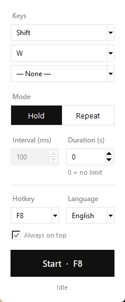

<p align="center">
  
</p>

<h1 align="center">Basılı Tut</h1>

<p align="center">
  A tiny key-holding tool for Windows.<br>
  <em>Windows için küçük ve basit bir tuş basılı tutma aracı.</em>
</p>

<p align="center">
  
  
  
</p>

<p align="center">
  <a href="#english">English</a> · <a href="#türkçe">Türkçe</a>
</p>

<p align="center">
  
</p>

---

## English

Holds down the keyboard key or mouse button you pick until you stop it.

### Features

- **Hold** mode keeps keys pressed, **Repeat** mode taps them at an interval you choose (from 10 ms)
- **Key combos**: up to 3 keys at once, e.g. `Shift + W`
- **Timer**: release automatically after a set number of seconds (0 = no limit)
- A–Z, 0–9, F1–F12, Space, Enter, Tab, Esc, Backspace, Caps Lock, Shift, Ctrl, Alt, arrows, Insert/Delete/Home/End/Page Up/Page Down, numpad and left/right/middle mouse buttons
- Global hotkey that works in any window (F6–F12, default **F8**)
- English and Turkish interface, picked automatically from your Windows language on first run
- "Always on top" option
- Remembers your settings (`%APPDATA%\BasiliTut\settings.json`)
- Sends scan codes, so most games pick up the key too
- No dependencies, only the Python standard library

### Installation

**Prebuilt exe:** download `BasiliTut.exe` from the [Releases](../../releases) page and run it.

**From source:** requires [Python 3.8+](https://www.python.org/downloads/).

```bash
git clone https://github.com/izzetaslan66/basili-tut.git
cd basili-tut
python basili_tut.pyw
```

You can also just double-click `basili_tut.pyw`.

### Usage

1. Pick a key in **Key 1**. For a combo, also pick **Key 2** / **Key 3**.
2. Choose a **Mode**: *Hold* keeps the keys down; *Repeat* presses and releases them every **Interval** milliseconds.
3. Optionally set a **Duration** in seconds. The keys are released when it runs out.
4. Press **START** or the hotkey (F8 by default). Press it again to stop.

Closing the window always releases the keys. The hotkey itself can't be picked as a key.

> Numpad digits work like the real numpad: with **NumLock off**, `Num 4` acts as the left arrow, `Num 0` as Insert and so on.

> If a game or program running as administrator doesn't see the key, run this app **as administrator** too.

### Building the exe

```bash
build.bat
```

This uses [PyInstaller](https://pyinstaller.org) to create `dist\BasiliTut.exe`.

To change the logo, edit [`tools/make_icon.py`](tools/make_icon.py) and run `python tools/make_icon.py` (requires Pillow).

### Running the tests

```bash
python -m unittest discover tests
```

The tests use a fake keyboard, so they never press real keys.

### Adding a language

Add a new language code (e.g. `"de"`) to the `LANGUAGES` dictionary in [`lang.py`](lang.py) and translate every key from the `"en"` entry. It shows up in the language list automatically. Pull requests are welcome.

### Contributing

1. Fork the repository.
2. Create a branch: `git checkout -b feature/my-feature`
3. Commit your changes and open a pull request.

Use the [Issues](../../issues) page to report bugs or suggest features.

### License

[MIT](LICENSE)

---

## Türkçe

Seçtiğin klavye ya da fare tuşunu, sen durdurana kadar senin yerine basılı tutar.

### Özellikler

- **Basılı tut** modu tuşları basılı tutar, **Tekrarla** modu seçtiğin aralıkla (10 ms'den başlayarak) basıp bırakır
- **Tuş kombinasyonu**: aynı anda en fazla 3 tuş, ör. `Shift + W`
- **Süre**: belirlenen saniye dolunca otomatik bırakır (0 = süresiz)
- A–Z, 0–9, F1–F12, Boşluk, Enter, Tab, Esc, Backspace, Caps Lock, Shift, Ctrl, Alt, ok tuşları, Insert/Delete/Home/End/Page Up/Page Down, numpad ve sol/sağ/orta fare tuşu
- Her pencerede çalışan kısayol (F6–F12, varsayılan **F8**)
- İngilizce ve Türkçe arayüz; ilk açılışta Windows'un diline göre otomatik seçilir
- "Her zaman üstte" seçeneği
- Ayarlar hatırlanır (`%APPDATA%\BasiliTut\settings.json`)
- Tuşları scan code ile gönderir, bu sayede çoğu oyun da tuşu algılar
- Ek kütüphane gerekmez, sadece Python'un kendi modüllerini kullanır

### Kurulum

**Hazır exe:** [Releases](../../releases) sayfasından `BasiliTut.exe` dosyasını indirip çalıştır.

**Kaynaktan:** [Python 3.8+](https://www.python.org/downloads/) kurulu olmalı.

```bash
git clone https://github.com/izzetaslan66/basili-tut.git
cd basili-tut
python basili_tut.pyw
```

`basili_tut.pyw` dosyasına çift tıklayarak da açabilirsin.

### Kullanım

1. **Tuş 1** kutusundan bir tuş seç. Kombinasyon için **Tuş 2** / **Tuş 3** kutularını da kullan.
2. **Mod** seç: *Basılı tut* tuşları basılı tutar; *Tekrarla* her **Aralık** milisaniyede bir basıp bırakır.
3. İstersen **Süre** (saniye) gir. Süre dolunca tuşlar bırakılır.
4. **BAŞLAT** butonuna ya da kısayola (varsayılan F8) bas. Durdurmak için tekrar bas.

Pencereyi kapatınca tuşlar her zaman bırakılır. Kısayol tuşu basılacak tuş olarak seçilemez.

> Numpad rakamları gerçek numpad gibi çalışır: **NumLock kapalıyken** `Num 4` sol ok, `Num 0` Insert gibi davranır.

> Yönetici olarak çalışan bir oyun ya da program tuşu algılamazsa uygulamayı da **yönetici olarak** çalıştır.

### Exe oluşturma

```bash
build.bat
```

Bu komut [PyInstaller](https://pyinstaller.org) ile `dist\BasiliTut.exe` dosyasını oluşturur.

Logoyu değiştirmek istersen [`tools/make_icon.py`](tools/make_icon.py) dosyasını düzenleyip `python tools/make_icon.py` komutunu çalıştır (Pillow gerekir).

### Testleri çalıştırma

```bash
python -m unittest discover tests
```

Testler sahte bir klavye kullanır, yani gerçek tuşlara basmaz.

### Yeni dil ekleme

[`lang.py`](lang.py) dosyasındaki `LANGUAGES` sözlüğüne yeni bir dil kodu (ör. `"de"`) ekle ve `"en"` girişindeki tüm anahtarları çevir. Dil listesi otomatik olarak güncellenir. Pull request'ler açıktır.

### Katkı

1. Repoyu fork'la.
2. Yeni bir dal aç: `git checkout -b ozellik/yeni-sey`
3. Değişikliklerini commit'le ve pull request aç.

Hata bildirmek ya da öneride bulunmak için [Issues](../../issues) sayfasını kullan.

### Lisans

[MIT](LICENSE)
